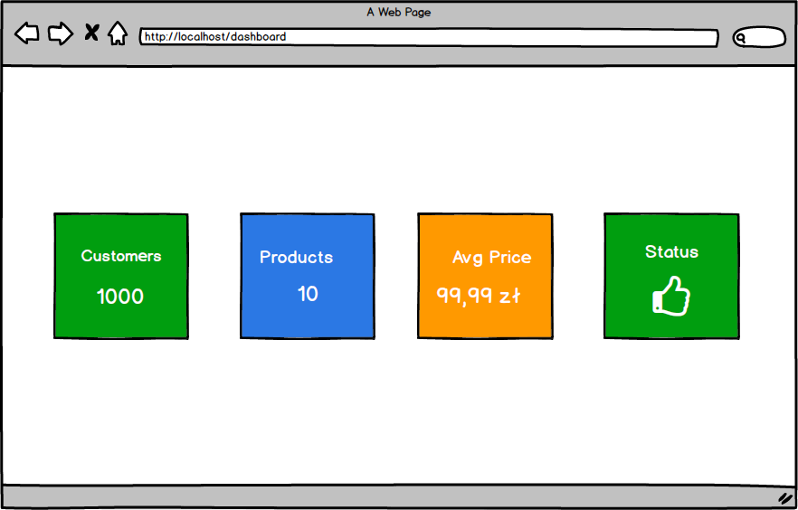

# Dzień 2: etapy 6-11

Ćwiczenia zakładają etapy z prowadzącym: formularze, przesyłanie zdjęć, kamerę, komponent `InfoCard` i preferencje w przeglądarce.
Logowanie jeszcze nie działa. Wszystkie dane są z pamięci (`Infrastructure`).

Dzień 2 zawiera **zadania D i E**: formularz produktu i pulpit. Budujesz je samodzielnie, według opisu.
Lista produktów z dnia 1 musi działać, bo ćwiczenia 6 i 8 z niej korzystają.

## Zadanie D: formularz produktu z walidacją (etap 6)

**Czas:** 45 minut. **Cel:** zbudować formularz dodawania i edycji produktu z walidacją FluentValidation.

**Kroki**

1. Dodaj pakiety do `BlazorApp`:
   ```bash
   dotnet add BlazorApp package FluentValidation --version 12.1.1
   dotnet add BlazorApp package GreatIdeas.Blazored.FluentValidation --version 3.0.0
   ```
2. Utwórz `Validators/ProductValidator.cs` (klasa `ProductValidator : AbstractValidator<Product>`) z regułami:
   - **Nazwa:** wymagana, do 50 znaków.
   - **Kod:** wymagany, format `XXX-NNNNN` (np. `ABC-12345`).
   - **Kolor:** pusty albo jeden z `Red`, `Green`, `Blue`.
   - **Cena:** większa od `0`, nie więcej niż `1999,99`.
   - **Opis:** wymagany, do 200 znaków.
   - **Data ważności:** wymagana, w przyszłości.
3. Zarejestruj walidator w `Program.cs`: `builder.Services.AddScoped<IValidator<Product>, ProductValidator>();`.
4. Utwórz `Components/Pages/Products/ProductForm.razor`: `EditForm` z `<FluentValidationValidator />`, pola `InputText` (nazwa, kod), `InputNumber` (cena), `InputSelect` (kolor), `InputDate` (data ważności), `InputTextArea` (opis). Pod każdym polem `ValidationMessage`. Parametry: `Product` oraz `OnSave` (`EventCallback<Product>`), wywoływany tylko po poprawnym formularzu.
5. Utwórz `Components/Pages/Products/Create.razor` z `@page "/products/create"`, który używa `ProductForm`. Na tym etapie nie zapisuj produktu do repozytorium. Po poprawnym formularzu wypisz w konsoli `Produkt zapisany poprawnie!`.
6. Utwórz `Components/Pages/Products/Edit.razor` z `@page "/products/{Id:int}/edit"`. Pobierz produkt przez `GetByIdAsync`, edytuj jego kopię (`Clone()`) w tym samym `ProductForm`. Oryginał zmienia się dopiero po zapisie.

**Kryteria akceptacji**

- [ ] Pusty formularz po kliknięciu `Zapisz` pokazuje komunikaty przy wymaganych polach.
- [ ] Kod `abc-1` i `ABC12345` daje komunikat o formacie `XXX-NNNNN`.
- [ ] Cena `0` i `2000` daje komunikaty, a data w przeszłości też.
- [ ] Poprawne dane wypisują w konsoli `Produkt zapisany poprawnie!`. Przy błędach formularz się nie wysyła.
- [ ] `/products/1/edit` używa tego samego formularza i ma te same reguły.

**Bonus ★:** dodaj `ValidationSummary` nad formularzem. Podświetl pola klasami `is-valid` i `is-invalid`.

<details>
<summary>Wskazówka</summary>

Komponent `ProductForm.razor` zaczyna się od `@using Blazored.FluentValidation` i `@using BlazorApp.Validators`. Pole `Name` w `Product` jest `required`, więc nowy produkt tworzysz jako `new() { Name = string.Empty }`.

Reguła kodu: `RuleFor(p => p.Code).Matches(@"^[A-Z]{3}-\d{5}$")`. Dodaj `.Cascade(CascadeMode.Stop)`, żeby pusty kod nie dostawał dwóch komunikatów.

Dla klasy `is-valid` / `is-invalid` użyj `EditContext.SetFieldCssClassProvider` z własnym providerem.

Pułapka: `ValidationMessage For="() => Product.Name"` musi wskazywać na właściwość, a nie na kopię pola.

Dla `Edit`: `Clone()` jest już w `Product` (wzór z `Customer`). Bez niego edycja zmieniłaby też wiersz na liście.
</details>

## Ćwiczenie 6: reguła walidacji po polsku (etap 6)

**Czas:** 15 minut. **Cel:** dodać regułę do `ProductValidator` i sprawdzić, jak komunikat trafia do formularza.

**Kroki**

1. W `ProductValidator` dodaj regułę: opis produktu nie może zawierać słowa `test` (bez względu na wielkość liter).
2. Komunikat ma być po polsku, np. `Opis nie może zawierać słowa „test”.`
3. Spróbuj zapisać produkt z takim opisem.

**Kryteria akceptacji**

- [ ] Komunikat pojawia się przy polu `Opis`.
- [ ] Formularz się nie zapisuje.
- [ ] Opis bez słowa `test` przechodzi bez błędu.
- [ ] Reguła działa też przy edycji produktu, nie tylko przy dodawaniu.

<details>
<summary>Wskazówka</summary>

`RuleFor(p => p.Description).Must(...)`, a w środku `!d.Contains("test", StringComparison.OrdinalIgnoreCase)`. Komunikat ustawiasz przez `.WithMessage(...)`.
</details>

## Ćwiczenie 7: limit zdjęcia (etap 7)

**Czas:** 15 minut. **Cel:** zmienić limit przesyłanego pliku i pokazać użytkownikowi, co wybrał.

**Kroki**

1. Zmień limit w `FileImageStore.MaxFileSize` z 2 MB na 1 MB.
2. Po wybraniu pliku, przed wysłaniem, pokaż jego nazwę i rozmiar w kilobajtach.
3. Wybierz plik większy niż 1 MB i sprawdź komunikat.

**Kryteria akceptacji**

- [ ] Plik powyżej 1 MB jest odrzucony z komunikatem `Plik jest za duży.`.
- [ ] Pod polem wyboru widać nazwę i rozmiar wybranego pliku.
- [ ] Plik mniejszy od limitu zapisuje się i pokazuje podgląd.
- [ ] Opis pod polem podaje poprawny limit.

<details>
<summary>Wskazówka</summary>

`e.File.Name` i `e.File.Size` (w bajtach). Zamiana na kilobajty: `e.File.Size / 1024`. Pole `ImageStore.MaxFileSize` jest już w formularzu, więc opis dostosuje się sam.
</details>

## Ćwiczenie 8: powrót na górę po zmianie strony (etap 8)

**Czas:** 15 minut. **Cel:** wywołać funkcję JS z modułu po zdarzeniu z komponentu Blazor.

**Kroki**

1. W `wwwroot/js/browser.js` dodaj funkcję `scrollToTop()`, która przewija okno na górę.
2. W `BrowserService` dodaj metodę `ScrollToTopAsync()`, która wywołuje tę funkcję przez moduł.
3. Na liście produktów wywołaj ją po zmianie strony w `Pager`.

**Kryteria akceptacji**

- [ ] Po kliknięciu `Następna` na dole listy widok wraca na górę.
- [ ] Funkcja JS jest w `browser.js`, a nie w `Pager`.
- [ ] Wywołanie jest po stronie C#, przez `BrowserService`.

<details>
<summary>Wskazówka</summary>

Wzór masz w `GoBackAsync`: moduł ładujesz raz, potem wołasz `InvokeVoidAsync("scrollToTop")`. W JS: `window.scrollTo({ top: 0 })`.
</details>

## Zadanie E: pulpit z kafelkami (etap 9)

**Czas:** 30 minut. **Cel:** zbudować pulpit z wielokrotnego użytku komponentem `InfoCard`.

**Szkic:**



**Kroki**

1. Utwórz `Components/Shared/InfoCard.razor` z parametrami:
   - `Title` (string, wymagany) - etykieta,
   - `Value` (string?) - główna wartość; `null` oznacza, że dane się ładują,
   - `Icon` (string?) - emoji,
   - `Accent` (string, domyślnie `primary`) - wariant `primary`, `success`, `warning` albo `danger`.
2. Stylizuj kafelek w `InfoCard.razor.css`: zaokrąglone rogi, cień (`box-shadow`), kolorowy pasek po lewej zależny od `Accent`.
3. Zastąp szablonowy `Components/Pages/Home.razor` (`@page "/"`) pulpitem z czterema kafelkami w jednym rzędzie:
   - 👤 `Aktywni klienci` - liczba z `ICustomerRepository`, bez klientów z `IsDeleted`,
   - 🛒 `Produkty` - liczba produktów z `IProductRepository`,
   - 💰 `Średnia cena produktu` - w formacie `ToString("C")`,
   - ✅ `Status systemu` - `Online` (wariant `success`) albo `Brak danych` (wariant `danger`, ikona ⚠️), gdy pobieranie się nie uda.
4. Dane pobierz w `OnInitializedAsync`. Dopóki ich nie ma, przekazuj `Value` jako `null`.

**Kryteria akceptacji**

- [ ] `/` pokazuje cztery kafelki w jednym rzędzie na szerokim ekranie.
- [ ] Liczby zgadzają się z listami produktów i klientów.
- [ ] Kafelek ma zaokrąglone rogi i cień, a jego styl jest w `InfoCard.razor.css`.
- [ ] Zmiana `Accent` zmienia kolor paska bez zmiany kodu `InfoCard`.

<details>
<summary>Wskazówka</summary>

`Value` jest tekstem, więc liczby zamieniaj przez `?.ToString()`, a średnią przez `ToString("C")`.

Układ siatki: `<div class="dashboard">` z `display: grid; grid-template-columns: repeat(auto-fit, minmax(220px, 1fr)); gap: 1rem;` albo klasy Bootstrap. Narzędzie do testów układu: https://flexboxlabs.netlify.app.

CSS izolowany działa tylko dla elementów `InfoCard`, więc klasy `.title` i `.value` nie kolidują z resztą aplikacji.
</details>

## Ćwiczenie 9: kafelek na pulpicie (etap 9)

**Czas:** 15 minut. **Cel:** dodać kafelek `InfoCard` i jego styl w CSS izolowanym.

**Kroki**

1. Na stronie startowej dodaj kafelek `Najdroższy produkt` z ceną najdroższego produktu.
2. Ustaw wariant `Accent="danger"`.
3. Wyróżnij tekst kafelka (np. pogrubienie) w `Home.razor.css`, a nie w `app.css`.

**Kryteria akceptacji**

- [ ] Kafelek pokazuje cenę najdroższego produktu.
- [ ] Kafelek ma wariant `danger`.
- [ ] Styl jest w pliku `Home.razor.css`.
- [ ] Inne strony nie zmieniły wyglądu.

<details>
<summary>Wskazówka</summary>

CSS izolowany działa dla elementów z tego komponentu. Wyróżnienie tekstu w kafelku może być zwykłym selektorem `.value` lub klasą na elemencie.
</details>

## Ćwiczenie 10: widok do druku (etap 10)

**Czas:** 15 minut. **Cel:** zrobić własny układ bez menu i przypisać go do jednej strony.

**Kroki**

1. Utwórz `Components/Layout/PrintLayout.razor` z samym nagłówkiem i treścią, bez menu.
2. Utwórz stronę `/p/{Id:int}/print`, która używa tego układu (`@layout PrintLayout`) i pokazuje nazwę, opis i cenę produktu.
3. Otwórz stronę z adresu i sprawdź, że nie ma menu.

**Kryteria akceptacji**

- [ ] `/p/1/print` pokazuje dane produktu bez menu i bez linku do panelu.
- [ ] Strona `/p/1` nadal używa `PublicLayout` bez zmian.
- [ ] Nieistniejący produkt daje komunikat, a nie wyjątek.

<details>
<summary>Wskazówka</summary>

Układ dziedziczy po `LayoutComponentBase`, a jego treść to `@Body`. Stronę przypisujesz dyrektywą `@layout`.
</details>

## Ćwiczenie 11: ostatni kolor w przeglądarce (etap 11)

**Czas:** 15 minut. **Cel:** zapisać wybór koloru w Local Storage i przywrócić go po odświeżeniu.

**Kroki**

1. Gdy użytkownik wybierze kolor na liście, zapisz go w Local Storage (`ProtectedLocalStorage`).
2. Gdy adres nie ma parametru `color`, przywróć zapisany kolor.
3. Zamknij kartę, otwórz ją ponownie i sprawdź, czy kolor wrócił. Potem zrób to samo z `ProtectedSessionStorage` i porównaj.

**Kryteria akceptacji**

- [ ] Po wyborze koloru i odświeżeniu strony kolor zostaje.
- [ ] Parametr `color` w adresie ma pierwszeństwo przed zapisanym kolorem.
- [ ] Po zamknięciu karty z Session Storage kolor znika, a z Local Storage zostaje.
- [ ] Umiesz powiedzieć, czym różnią się te dwa magazyny.

<details>
<summary>Wskazówka</summary>

Odczyt z przeglądarki jest asynchroniczny i wymaga pierwszego renderowania. Wczytuj wartość w `OnAfterRenderAsync(firstRender)`, a nie w `OnInitializedAsync`.
</details>

---

## Wyzwanie dnia 2: Duplikuj produkt

**Czas:** 45-60 minut. **Etapy:** 6-11.

**Scenariusz.** Pracownik dodaje serię podobnych produktów. Nie chce wpisywać wszystkiego od zera.

**Wymagania**

1. Na liście produktów przycisk `Duplikuj` przy każdym wierszu. Prowadzi do `/products/create?copyFrom={id}`.
2. Formularz dodawania jest wypełniony danymi z oryginału. Nazwa dostaje dopisek ` (kopia)`, kod zostaje pusty.
3. Zapis działa tym samym formularzem `ProductForm` z walidacją. Po zapisie otwiera się szczegóły nowego produktu.
4. Na stronie szczegółów przycisk `Kopiuj kod` kopiuje kod do schowka przez moduł JS. Potwierdzenie `Skopiowano` znika po 2 sekundach.
5. Szkic niezapisanego formularza przeżywa odświeżenie strony (Session Storage). Po udanym zapisie szkic jest usuwany.

**Kryteria akceptacji**

- [ ] `Duplikuj` otwiera wypełniony formularz.
- [ ] Nazwa ma dopisek `(kopia)`, kod jest pusty.
- [ ] Walidacja działa także dla skopiowanego produktu.
- [ ] `Kopiuj kod` kopiuje wartość kodu i pokazuje potwierdzenie na chwilę.
- [ ] Odświeżenie formularza w trakcie wpisywania przywraca szkic.
- [ ] Po zapisie szkic znika: nowe otwarcie `Dodaj produkt` daje pusty formularz.

**Bonus ★:** nieistniejący `copyFrom` pokazuje komunikat zamiast pustego formularza.

<details>
<summary>Podpowiedź 1</summary>

`[SupplyParameterFromQuery] public int? CopyFrom { get; set; }`. Oryginał pobierasz z repozytorium i kopiujesz przez `Clone()`. Ustaw `Id = 0`.
</details>

<details>
<summary>Podpowiedź 2</summary>

`ProtectedSessionStorage` nie działa podczas prerenderingu. Odczyt szkicu zrób w `OnAfterRenderAsync(firstRender)`, a potem wywołaj `StateHasChanged()`.
</details>

<details>
<summary>Podpowiedź 3</summary>

Szkic zapisujesz po każdej zmianie pola. Opakuj formularz w `div` z `@onchange`: zdarzenie `change` przechodzi w górę drzewa, więc złapiesz zmiany wszystkich pól.
</details>
